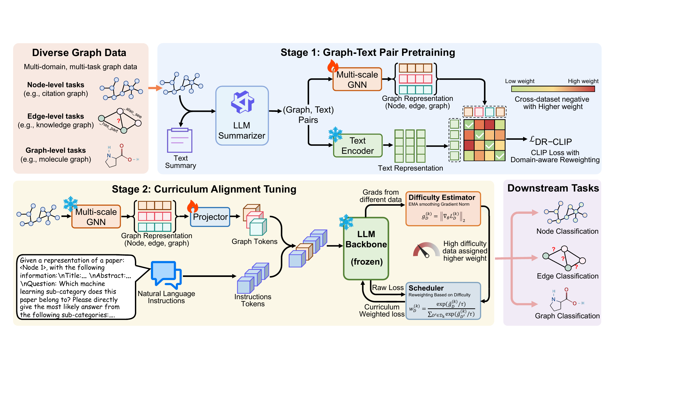

# Uni-GraphLLM

Official implementation of **Uni-GraphLLM: Unified Graph Large Language Model for Multi-Domain
Multi-Task Graph Alignment Instruction Tuning** (NeurIPS 2026).

Haibo Chen, Xin Wang, Jiaheng Chao, Ling Feng, Wenwu Zhu (Tsinghua University)

## Overview

Graph Language Models (GLMs) usually use a GNN as the graph encoder and align its representations
with an LLM through alignment instruction tuning. Existing GNN-based GLMs are mostly built for a
single domain or task, and do not study how GNN representations from diverse domains and tasks can be
aligned with the LLM token space as unified graph tokens. Uni-GraphLLM incorporates a shared
multi-domain, multi-task GNN encoder into a GLM and addresses two challenges:

1. **Generalizable text-aligned representation learning.** Graph structures, feature distributions,
   and supervision signals vary widely across domains and tasks, and task-specific GNN training gives
   no textual-semantic guidance.
2. **Varying alignment difficulty.** Different graph data and instructions differ in how compatible
   they are with the LLM token space, so a fixed alignment strategy is suboptimal.



The framework has two stages:

- **Graph-text pair pretraining.** An LLM summarizer (Qwen3-8B) writes a textual description for each
  graph instance. A multi-scale GNN encoder produces node-, edge-, or graph-level representations in
  one shared space and is trained against a frozen Sentence-BERT text encoder with a domain-aware
  reweighted CLIP loss (DR-CLIP), which gives larger weights to negatives from more distant domains.
- **Curriculum alignment tuning.** The GNN encoder and the LLM are frozen and only the projector is
  trained. Per-domain alignment difficulty is estimated online from the projector gradient norm,
  smoothed with a running-mean warmup followed by EMA, and turned into domain weights with a
  temperature softmax so that harder domains get more weight.

The model covers node classification (Cora, PubMed, Wiki-CS, Arxiv), link classification (WN18RR,
FB15K237) and molecule classification (ChemPCBA, ChemHIV).

## Results

Multi-domain, multi-task learning: one model is instruction-tuned on the combined training sets of
all eight datasets and evaluated on each test split without dataset-specific fine-tuning. Accuracy (%)
for node and edge tasks, ROC-AUC (%) for graph tasks; all methods use Vicuna-7B-v1.5 except GOFA
(Mistral-7B). N.S. means the task is not supported.

| Method | Cora | PubMed | Wiki-CS | Arxiv | WN18RR | FB15K237 | ChemPCBA | ChemHIV | Avg. |
|---|---|---|---|---|---|---|---|---|---|
| Vicuna-7B | 56.67 | 78.92 | 62.34 | 43.75 | 34.84 | 56.01 | 46.47 | 30.36 | 51.17 |
| LLaMA-2-7B | 29.45 | 25.36 | 22.22 | 6.33 | 29.16 | 20.60 | 51.12 | 50.09 | 29.29 |
| GraphGPT | 57.59 | 73.45 | 49.20 | 67.63 | N.S. | N.S. | N.S. | N.S. | 61.97 |
| LLaGA | 74.71 | 68.54 | 69.16 | 73.83 | N.S. | N.S. | N.S. | N.S. | 71.56 |
| GOFA | 63.88 | 64.72 | 66.77 | 66.11 | 21.95 | 54.41 | 60.61 | 49.78 | 56.03 |
| TEA-GLM | 62.38 | 85.13 | 55.19 | 66.81 | 92.85 | 91.85 | 80.40 | 67.13 | 75.22 |
| **Uni-GraphLLM** | **76.98** | **90.49** | **76.65** | **74.22** | **93.52** | **91.96** | **81.69** | **70.09** | **81.95** |

Cross-domain and cross-task generalization: instruction tuning on Arxiv only, then evaluation on
other node datasets (cross-domain) and on link datasets (cross-task). Accuracy (%).

| Method | Cora | PubMed | Wiki-CS | WN18RR | FB15K237 |
|---|---|---|---|---|---|
| GraphGPT | 31.53 | 38.99 | 37.78 | - | - |
| LLaGA | 13.01 | 25.74 | 5.64 | - | - |
| GOFA | 16.30 | 51.14 | 40.11 | 18.79 | 16.93 |
| TEA-GLM | 43.33 | 34.33 | 36.69 | 22.65 | 11.72 |
| **Uni-GraphLLM** | **55.17** | **77.31** | **63.93** | **24.12** | **55.27** |

Uni-GraphLLM also works with other LLM backbones: with Qwen3-8B in the multi-domain, multi-task
setting the average rises from 81.95 to 84.10. Ablations, difficulty-proxy comparisons, efficiency
and hyperparameter studies are in the paper.

## Environment

```bash
bash setup_env.sh uni-graphllm      # creates the conda env with pinned versions
conda activate uni-graphllm
```

Pinned stack (see `setup_env.sh`): python 3.10, torch 2.7.1 (cu128), torch_geometric 2.8.0.post1
(pure-python core, no PyG C++ extensions), transformers 5.14.1, tokenizers 0.22.2, peft 0.18.1,
accelerate 1.14.0, sentencepiece, scikit-learn, rapidfuzz, rdkit. torch >= 2.6 is required for Qwen3.

## Data and checkpoints

Processed datasets and trained weights are hosted on Hugging Face at
[chen1222/Uni-GraphLLM](https://huggingface.co/datasets/chen1222/Uni-GraphLLM): `gfm/` (`GFT-data/`,
`summary/`, `instructions/`, `splits/`) and `saved_model/`. Download and place them as shown in
[Layout](#layout):

```bash
pip install -U huggingface_hub
hf download chen1222/Uni-GraphLLM --repo-type dataset --local-dir uni-graphllm-release
mv uni-graphllm-release/gfm <root>/data/gfm
mv uni-graphllm-release/saved_model <root>/Uni-GraphLLM/saved_model
```

LLM backbones are **not** redistributed here; download them yourself and put them under `llms/`:

- Vicuna-7B-v1.5 → `llms/llms/lmsys/vicuna-7b-v1.5`
- Qwen3-8B → `llms/llms/Qwen3-8B`

After moving the data into place, the data root defaults to `../data/gfm` relative to this repo.
Override with `UNIGRAPHLM_DATA_ROOT=/path/to/gfm` if needed.

`saved_model/` contains the frozen graph encoder `gnn/unignn_4096_100.pt`, shared by all runs, and
the trained projectors `first_model/<prefix>7_fm_<datasets>_epoch0_end.pth` with prefix `vicuna_`
or `qwen3_`. `<datasets>` is `Cora+Pubmed+wikics+arxiv+WN18RR+FB15K237+chempcba+chemhiv`; the `7`
is `--num_token`.

## Layout

```
<root>/
  Uni-GraphLLM/                        # this repo
    saved_model/
      gnn/unignn_4096_100.pt           # ← from Hugging Face
      first_model/*.pth                # ← from Hugging Face
  data/gfm/                            # ← from Hugging Face
    GFT-data/
    summary/
    instructions/
    splits/
  llms/llms/
    lmsys/vicuna-7b-v1.5               # ← Hugging Face / upstream
    Qwen3-8B
```

## Training

```bash
CUDA_VISIBLE_DEVICES=0 accelerate launch train_glm.py \
    --freeze_llama --prefix <prefix> \
    --dataset Cora+Pubmed+wikics+arxiv+WN18RR+FB15K237+chempcba+chemhiv \
    --backbone ../llms/llms/lmsys/vicuna-7b-v1.5 \
    --pretrain_gnn saved_model/gnn/unignn_4096_100.pt \
    --att_d_model 768 --gnn_output 768 --gt_layers 3 --num_token 7 \
    --batch_size 3 --grad_steps 1 --clip_grad_norm 1.0 --epoch 1 --weight_decay 0. \
    --max_text_length 3000 --gen_max_length 64 --lr 0.004 \
    --curriculum_mean_warmup_ratio 0.01 --curriculum_ema_momentum 0.7 --seed 0
```

The checkpoint is written to `saved_model/first_model/<prefix><num_token>_fm_<dataset>_epoch0_end.pth`.
The file contains the frozen graph encoder and trained projector state dictionaries; it does not
contain LLM weights.

For Qwen3, use the same command with:

```bash
--prefix qwen3_ --backbone ../llms/llms/Qwen3-8B --batch_size 2
```

Qwen3 uses batch size 2 per process; batch size 3 may exhaust GPU memory.

## Evaluation

One test set per run; repeat for each of the 8 datasets:

```bash
CUDA_VISIBLE_DEVICES=0 accelerate launch --num_processes 1 train_glm.py \
    --freeze_llama --inference --best_epoch 0 --num_token 7 \
    --prefix vicuna_ \
    --dataset Cora+Pubmed+wikics+arxiv+WN18RR+FB15K237+chempcba+chemhiv \
    --test_dataset chemhiv --batch_size 40 \
    --backbone ../llms/llms/lmsys/vicuna-7b-v1.5 \
    --pretrain_gnn saved_model/gnn/unignn_4096_100.pt \
    --att_d_model 768 --gnn_output 768 --gt_layers 3 \
    --max_text_length 3000 --gen_max_length 64 --seed 0
```

Batch sizes used: 40 (Cora, PubMed, WN18RR, FB15K237, ChemPCBA, ChemHIV), 20 (Wiki-CS, Arxiv).
Metrics go to `results/<prefix><result_tag>/<test_dataset>/metric.txt`: accuracy and macro-F1 for
node/link tasks, ROC-AUC for ChemPCBA / ChemHIV. Use `--result_tag` to add a suffix to the results
directory and `--greedy` for deterministic decoding.

`--top_p`, `--auc_source` and `--chem_feat_ids` default to a preset chosen from the backbone's
`model_type` (`BACKBONE_PRESETS` in `config.py`), for both training and evaluation, so the released
checkpoints are reproduced without extra flags. Passing a flag explicitly overrides the preset; the
resolved values are printed as `[preset] ...` at startup.

## Citation

If you find this work useful, please cite:

```bibtex
@inproceedings{chen2026unigraphllm,
  title     = {Uni-GraphLLM: Unified Graph Large Language Model for Multi-Domain Multi-Task Graph Alignment Instruction Tuning},
  author    = {Chen, Haibo and Wang, Xin and Chao, Jiaheng and Feng, Ling and Zhu, Wenwu},
  booktitle = {Advances in Neural Information Processing Systems},
  year      = {2026}
}
```
